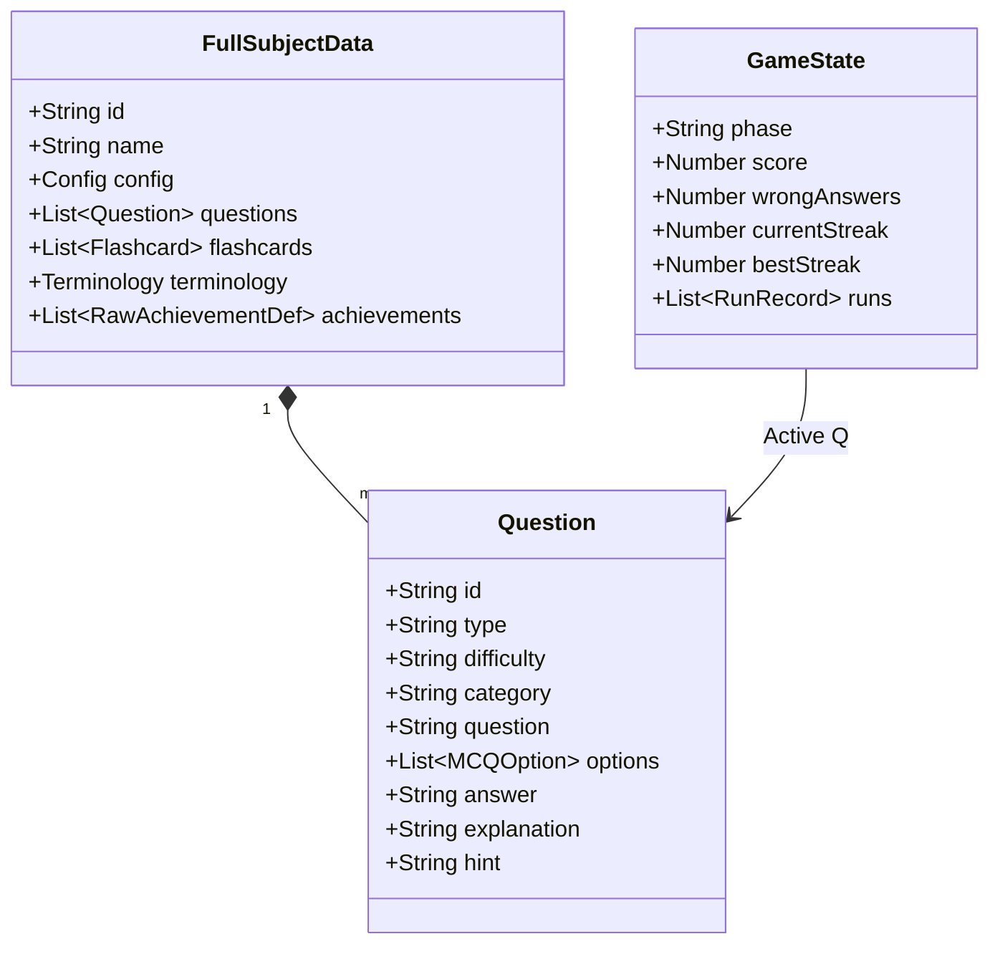

# 2. Interface Properties

This document maps the interface properties and data pipelines for the application.

### Core Data Models
Defined heavily in `lib/types/mold-types.ts`, the principal models dictating the domain boundaries are:
- `FullSubjectData`: Represents the fully hydrated model of a subject being tested or managed.
- `Question`: Defines varying structures like MCQ (`MCQOption`) or TrueFalse questions.
- `GameState`: The current atomic instance of a game run, capturing `GamePhase`, active scores, and timelines.
- `AchievementCondition`: Logical evaluations determining progression capabilities.
- `Terminology`: Used for learning modes, detailing specific concepts or terms (`TerminologyEntry`).

### Interface Contracts
- **Subject Validation Interface (`SubjectSchema`)**: Validates inbound JSON to ensure the structure strictly conforms to the `FullSubjectData` type, guaranteeing stability across the persistence layer.
- **Game Engine Dispatch Interface**: Component interactions dispatch structured objects (e.g. `{ type: 'ANSWER', payload: ... }`) ensuring predictability within the reducer pipeline.

## Interface Class Diagram

