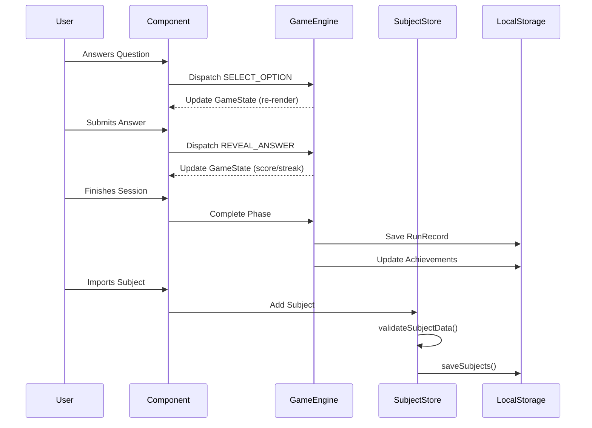

# 3. Data Pipelines

This document maps the data pipelines mapping memory state to storage.

### Data Persistence Pipeline
`lib/subject/subject-persistence.ts` operates as the primary data pipeline bridging active memory and browser storage constraints.
- `validateSubjectData(raw: unknown)`: Secures inbound JSON parsing constraints, avoiding schema mismatch.
- `loadSubjects()` and `saveSubjects()`: Interfacing points with Next.js environment mapping directly to local persistence layers.

### Game State Reducer Pipeline
Within `lib/game/game-engine.tsx`, state mutations operate within a unidirectional data flow. Actions such as answer selections trigger state shifts that are then broadcasted back up to listeners mapped via `useGameEngine`.

## Persistence Sequence

