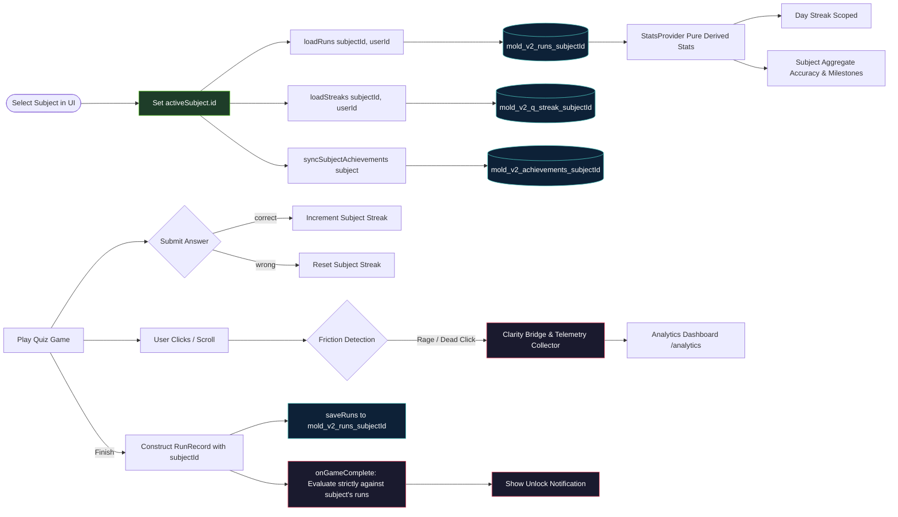

# Data Flow Diagram (Dimension 2)

> Generated by Graphify. Last updated: October 2026 (Subject Scoped Data Isolation).

## Diagram

## Analysis Notes

- **Critical paths:** The separation of storage keys by `subjectId` guarantees that runs, streaks, and achievements are compartmentalized.
- **Risk areas:** Legacy migration checks ensure users with existing un-namespaced keys do not lose historical progress.
- **Async boundaries:** `syncSubjectAchievements` and `onGameComplete` are async boundaries to support drop-in Firebase Firestore transitions.
